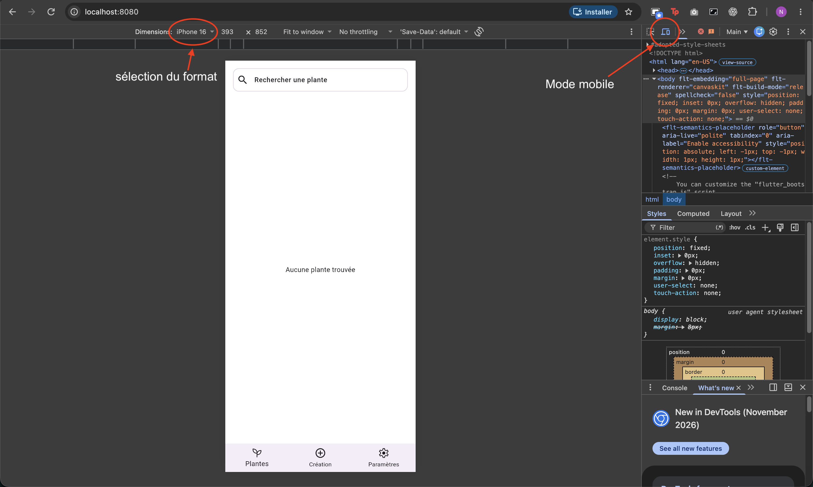

# Application de mesure de plante - CIRAD

## Sommaire

- [Contributeurs](#contributeurs)
  - [IUT Orléans](#iut-orléans)
- [Maquette de l'application](#maquette-de-lapplication)
- [Lancer les tests du backend](#lancer-les-tests-du-backend)
- [Lancer l'app en mode terminal pour le backend](#lancer-lapp-en-mode-terminal-pour-le-backend)
- [MTG Editor — Guide de lancement et de test](#mtg-editor--guide-de-lancement-et-de-test)
  - [Méthode 1 : Lancement rapide via Docker](#méthode-1--lancement-rapide-via-docker)
    - [Prérequis](#prérequis)
    - [Étapes de lancement](#étapes-de-lancement)
    - [Tester l'affichage mobile depuis un émulateur](#tester-laffichage-mobile-depuis-un-émulateur)
    - [Arrêter l'application](#arrêter-lapplication)
    - [Notes](#notes)

## Contributeurs

### IUT Orléans
- Nicolas CAMERA
- Titouan GUERRIER
- Bastien MOINS
- Esteban ROUSSEAU

## Maquette de l'application  
 [Figma](https://www.figma.com/design/dHv55YwCSlYOFtGL53j3P3/CIRAD-ETUdiant?node-id=4-540&t=lvdQ6Yk2dqfYwPox-1)

## LANCER LES TESTS DU BACKEND

    - Commencer par se mettre dans le répertoire mtgeditor/packages/backend_mtg

    - Pour lancer un fichier test précis:
      dart test test/MON_FICHIER.dart

    - Pour lancer tous les tests
      dart test --coverage=coverage test/models


> Une fois les tests effectués, il faut générer le rapport LCOV qui contient les résultats des tests ainsi que le coverage

    - Pour convertir les données du test en rapport LCOV, activez l'outil suivant (une seule activation suffit)
      dart pub global activate coverage

    - Pour générer le rapport .info
      dart pub global run coverage:format_coverage \
        --lcov \
        --in=coverage \
        --out=coverage/lcov.info \
        --packages=.dart_tool/package_config.json \
        --report-on=lib

> Vous avez maintenant dans le répertoire mtgeditor/packages/backend_mtg/coverage un fichier lcov.info qui contient les informations des tests et le coverage

    Voici comment lire le fichier
        - SF: Le fichier testé
        - DA(num_ligne, nb_test): Le nombre de fois ou la ligne num_ligne est testé
        - LF: Nombre de ligne total des fonctions visées par les tests
        - LH: Nombre de ligne total testé des fonctions visées par les tests  
        - end_of_record: fin du rapport pour ce fichier test

    Le fichier est peu compréhensible, vous pouvez donc instaler lcov pour pouvoir transformer le rapport en tableau

        - Installer lcov
          sudo apt install lcov

        - Générer le coverage en mode web (HTML)
          genhtml coverage/lcov.info --output-directory coverage/html

        - Générer le coverage en mode terminal
          lcov --summary coverage/lcov.info

## LANCER L'APP EN MODE TERMINAL POUR LE BACKEND

- Avoir une version de dart sur l'environnement
- Aller dans le repertoire packages/backend_mtg
- Installer les dépendances nécessaire avec "dart pub get"

- Lancer l'app avec "dart run bin\app_backend_terminal.dart"


# MTG Editor — Guide de lancement et de test

Ce guide explique comment démarrer l'application **MTG Editor** en local pour la tester, soit via **Docker** (recommandé, aucune installation de Flutter requise), soit directement depuis **VS Code**.

---

## Méthode 1 : Lancement rapide via Docker

Cette méthode rend disponible l'application web dans un conteneur.

### Prérequis
**Docker** installé et **démarré**.

### Étapes de lancement
1. Ouvrir un terminal à la racine du dépôt `mtgeditor`.
2. Construire et démarrer le conteneur :
   ```bash
   docker compose up --build
   ```
   *(Lors des lancements suivants, si le code n'a pas été modifié, la commande `docker compose up` suffit.)*
3. Une fois le serveur démarré, ouvrir l'application dans un navigateur web à l'adresse :
   **http://localhost:8080**

### Tester l'affichage mobile depuis un émulateur
* **Via les outils développeur du navigateur :** Ouvrir `http://localhost:8080`, appuyer sur `F12` puis activer le mode appareil mobile.



### Arrêter l'application
Appuyer sur `Ctrl + C` dans le terminal, puis nettoyer le conteneur avec :
```bash
docker compose down
```

### Notes

* **Sauvegarde des données :** En version web la base de données ne fonctionne pas, les plantes ne sont donc pas conservées.